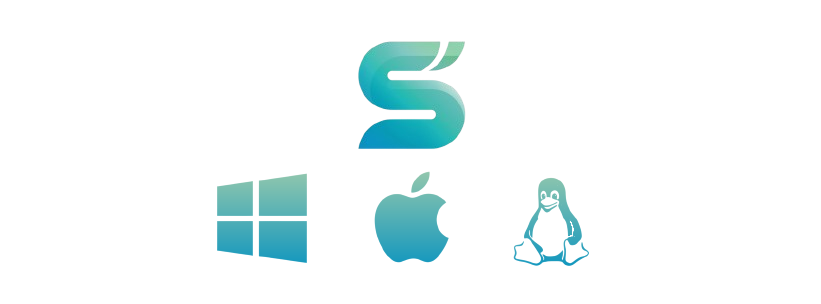
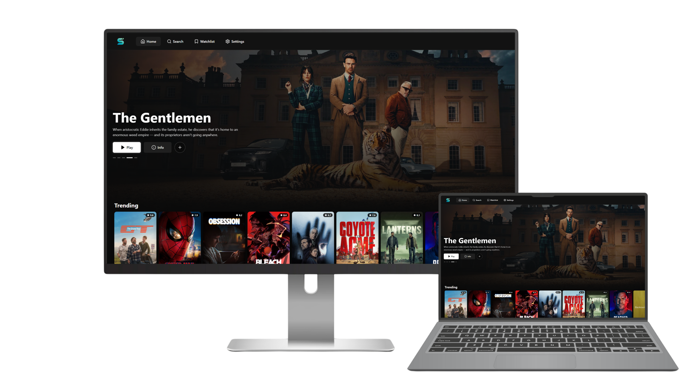

<h1 align="center">Streamflix Desktop</h1>

<p align="center">
  
  <br />
  <strong>Десктоп-порт</strong> — самостоятельная версия Streamflix Reborn для компьютера
  <br />
  Открытое приложение с учебным стриминговым интерфейсом: бэкенд на Kotlin, фронтенд на Next.js / Electron
  <br />
  <br />
   <a href="https://github.com/MyLuxy/streamflix-desktop/releases/latest"></a>
  <a href="https://github.com/sponsors/MyLuxy"></a>
</p>

<p align="center">
  <a href="README.md">English</a> ·
  <b>Русский</b>
</p>

<details>
  <summary>Содержание</summary>

- [О проекте](#о-проекте)
  - [Что такое Streamflix Desktop?](#-что-такое-streamflix-desktop)
  - [Возможности](#возможности)
  - [Из чего собрано](#из-чего-собрано)
- [С чего начать](#с-чего-начать)
  - [Что нужно](#что-нужно)
  - [Установка](#установка)
- [Разработка](#разработка)
- [Как помочь](#как-помочь)
- [Правовая оговорка](#правовая-оговорка)
- [Авторы](#авторы)
- [Лицензия](#лицензия)
</details>

## О проекте

<p align="center">
  
</p>

**Streamflix Desktop** — самостоятельный десктоп-порт [Streamflix Reborn](https://git.gay/streamflix-reborn2/streamflix), продолжения оригинального Streamflix от [Lory-Stan TANASI](https://github.com/stantanasi). Вместо Android-оболочки — бэкенд на Kotlin/JVM и веб-интерфейс на Next.js, упакованный в нативное приложение через Electron.

Streamflix Desktop даёт единый интерфейс к публичным стриминговым источникам: каталог и потоки собираются локальным бэкендом.

Приложение задумано для ознакомления и личного использования. Ответственность за то, что вы смотрите и имеете ли на это право, лежит на вас.

### 🖥️ Что такое Streamflix Desktop?

- **Отдельный форк**: не привязан к Android-репозиторию, пакеты под Windows / macOS / Linux
- **Та же идея**: открытый код и образовательный подход
- **Нативный десктоп**: без Android Studio и эмулятора
- **С уважением к оригиналу**: порт сделан с учётом работы автора исходного проекта

### Возможности

- Открытый интерфейс без рекламы
- Агрегация контента с нескольких сторонних источников
- Без обязательной регистрации в самом приложении
- Скачивание для офлайн-просмотра
- Продолжение с места остановки
- Нативное приложение (Windows / macOS / Linux)

### Из чего собрано

- [Kotlin](https://kotlinlang.org) (бэкенд, `shared/` + `desktop/`)
- [Retrofit](https://square.github.io/retrofit) / [OkHttp](https://square.github.io/okhttp) / [Jsoup](https://jsoup.org)
- [Next.js](https://nextjs.org) / [React](https://react.dev) (фронтенд, `web/`)
- [Electron](https://www.electronjs.org) (оболочка, `desktop-client/`)
- Coroutines

## С чего начать

### Что нужно

- [JDK 17](https://adoptium.net) (рекомендуется Temurin)
- [Node.js](https://nodejs.org) (LTS)

### Установка

Клонируйте репозиторий:

```bash
git clone https://github.com/MyLuxy/streamflix-desktop.git
```

## Разработка

Бэкенд (Kotlin HTTP API + HLS-прокси), из корня репозитория:

```bash
./gradlew :desktop:runBackend
```

Фронтенд (Next.js), из папки `web/`:

```bash
npm install
npm run dev
```

## Как помочь

Open source живёт вкладами сообщества. Любая помощь **очень ценится**.

1. Сделайте форк проекта
2. Создайте ветку (`git checkout -b feature/amazing-feature`)
3. Закоммитьте изменения (`git commit -m 'feat: add some amazing feature'`)
4. Запушьте ветку (`git push origin feature/amazing-feature`)
5. Откройте pull request

## Правовая оговорка

**ВАЖНО: приложение только для ознакомления и личного использования.**

- Streamflix не хостит, не хранит и не раздаёт защищённый авторским правом контент
- Весь контент идёт со сторонних сайтов и провайдеров
- Право на доступ к контенту — зона ответственности пользователя
- Разработчики не поощряют нарушение авторских прав
- Соблюдайте законы вашей страны
- Претензии по контенту — к реальным хостерам, не к этому приложению
- Это поисковый агрегатор, а не видеохостинг
- На наших серверах нет защищённых материалов

## Юридическое уведомление

Приложение предоставляется «как есть» в учебных целях. Разработчики:

- не претендуют на владение контентом
- не зарабатывают на чужих материалах
- не контролируют сторонних провайдеров
- советуют поддерживать авторов легальными способами
- рекомендуют официальные сервисы, когда они доступны

## Авторы

### Создатель оригинала
- **[Lory-Stan TANASI](https://github.com/stantanasi)** — автор оригинального Streamflix

### Streamflix Reborn
- **[streamflix-reborn2](https://github.com/streamflix-reborn2)** — поддержка Streamflix Reborn (Android)

### Десктоп-порт
- **[MyLuxy](https://github.com/MyLuxy)** — поддержка десктоп-порта

## Лицензия

Проект под лицензией `Apache-2.0` — подробности в файле [LICENSE](LICENSE).

<p align="center">
  <br />
  © 2022 Lory-Stan TANASI. Все права защищены (оригинальный проект)
  <br />
  © 2025 Streamflix Reborn. С уважением к исходной работе.
</p>
